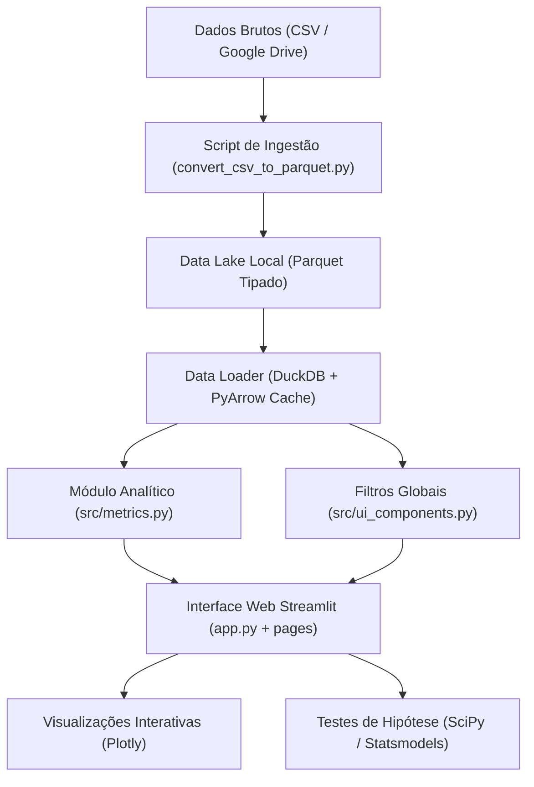

# 🗳️ Observatório do Financiamento Eleitoral (PACD)

[](https://www.python.org/)
[](https://streamlit.io/)
[](https://duckdb.org/)
[](https://arrow.apache.org/)
[](LICENSE)

Plataforma de inteligência analítica e investigação quantitativa sobre a influência do capital nas eleições no estado da Paraíba, integrando microdados oficiais do **Tribunal Superior Eleitoral (TSE)** e cruzamentos com o **Quadro de Sócios e Administradores (QSA/Receita Federal)**.

---

## 📌 Sumário

- [Visão Geral](#-visão-geral)
- [Hipóteses Científicas Investigadas](#-hipóteses-científicas-investigadas)
- [Módulos da Aplicação](#-módulos-da-aplicação)
- [Arquitetura & Tecnologias](#-arquitetura--tecnologias)
- [Estrutura do Projeto](#-estrutura-do-projeto)
- [Instalação & Configuração](#-instalação--configuração)
- [Como Executar](#-como-executar)
  - [Aplicação Web (Streamlit)](#1-iniciar-a-aplicação-web)
  - [Pipeline de Dados (CLI)](#2-executar-a-ingestão-e-conversão-de-dados)
  - [Execução dos Testes](#3-executar-a-suíte-de-testes)
- [Governança & Conformidade LGPD](#-governança--conformidade-lgpd)

---

## 🔍 Visão Geral

O financiamento de campanhas é um dos fatores mais determinantes para a competitividade e a equidade democrática. Esta plataforma foi desenvolvida para possibilitar uma análise empírica, visual e estatisticamente rigorosa das prestações de contas eleitorais (2018 a 2024), respondendo a perguntas centrais como:

1. **Concentração Oligárquica:** O capital eleitoral é monopolizado por um grupo restrito de candidaturas de elite?
2. **Custo do Voto:** Qual é o custo financeiro real de cada voto obtido em diferentes cargos (majoritários e proporcionais)?
3. **Porta Giratória e Triangulação:** Existem doadores pessoas físicas que recebem recursos de volta via contratação de suas empresas (fornecedores de campanha)?
4. **Geopolítica do Financiamento:** Qual a proporção de capital endógeno (da própria UF) versus exógeno (outros estados)?

---

## 💡 Hipóteses Científicas Investigadas

A plataforma estrutura suas análises em torno de quatro hipóteses empíricas:

| Hipótese | Denominação | Descrição |
| :--- | :--- | :--- |
| **H1** | **Teto de Vidro Financeiro** | Existe uma barreira financeira mínima (custo por voto de entrada) abaixo da qual a viabilidade eleitoral é estatisticamente nula. |
| **H2** | **Assimetria de Pareto** | A distribuição de receita eleitoral segue uma lei de potência acentuada, com concentração no decil superior (Top 10%). |
| **H3** | **Efeito Porta Giratória** | Recursos doados retornam a pessoas físicas ou jurídicas ligadas ao próprio doador por meio de prestação de serviços eleitorais (QSA / CNPJ Básico). |
| **H4** | **Endogeneidade Geográfica** | Campanhas municipais são fortemente financiadas por capital local, enquanto pleitos majoritários atraem expressivo capital exógeno. |

---

## 🧭 Módulos da Aplicação

A aplicação é organizada no padrão multi-páginas do Streamlit com sincronização global de filtros via `st.session_state`:

### 1. Página Inicial (`app.py`)
- Apresenta o problema de pesquisa, hipóteses e objetivos acadêmicos.
- Cartões de macroindicadores da seleção ativa (Volume financeiro, Candidaturas, Doadores e Transações).
- Guia de navegação direta para os módulos especializados.

### 2. Visão Geral (`pages/1_visao_geral.py`)
- **KPIs Estratégicos:** Total arrecadado, ticket médio de doações, taxa média de sucesso e candidato recordista.
- **Top Doadores:** Ranking de pessoas físicas e jurídicas com mascaramento protetivo (LGPD).
- **Candidatos Recordistas:** Maiores receitas por cargo e partido.
- **Distribuição de Capital:** Histogramas e curvas de densidade em escala logarítmica.

### 3. Custo do Voto & Teste H1 (`pages/2_custo_do_voto.py`)
- **Piso de Viabilidade:** Identificação do valor mínimo de receita e custo por voto entre eleitos.
- **Dispersão Votos vs. Receita:** Visualização interativa log-log diferenciando eleitos, suplentes e não eleitos.
- **Teste Estatístico Não-Paramétrico:** Teste de **Mann-Whitney U** comparando a distribuição de receitas entre eleitos e não eleitos, com cálculo de p-valor e significância estatística.
- **Tabela Analítica:** Detalhamento por candidato com métricas de eficácia financeira.

### 4. Porta Giratória & Cruzamento QSA (`pages/3_porta_giratoria.py`)
- **Identificação de Conflitos de Interesse:** Rastreamento de doadores que figuram simultaneamente como fornecedores contratados da mesma campanha ou grupo político.
- **Diagrama Sankey Interativo:** Mapeamento visual do fluxo de recursos doadores $\rightarrow$ candidatos $\rightarrow$ fornecedores.
- **Taxa de Retorno:** Cálculo do percentual do capital doado que retornou ao doador/fornecedor (`(valor_fornecedor / valor_receita) * 100`).

---

## 🛠️ Arquitetura & Tecnologias



- **Frontend & Interface:** [Streamlit](https://streamlit.io/) (layout responsivo e componentes reativos).
- **Motor de Consulta & Storage:** [DuckDB](https://duckdb.org/) e [Apache Arrow/Parquet](https://arrow.apache.org/) para consultas colunares velozes e baixo consumo de memória.
- **Visualização de Dados:** [Plotly Express & Graph Objects](https://plotly.com/python/) (gráficos de dispersão, barras, histogramas e diagramas Sankey).
- **Análise Estatística:** [NumPy](https://numpy.org/), [Pandas](https://pandas.pydata.org/), [SciPy](https://scipy.org/) e [Statsmodels](https://www.statsmodels.org/).
- **Qualidade & Testes:** [unittest](https://docs.python.org/3/library/unittest.html) com cobertura de conversão, carregamento e funções métricas.

---

## 📂 Estrutura do Projeto

```text
pacd/
├── app.py                      # Ponto de entrada e página inicial do Streamlit
├── requirements.txt            # Dependências e bibliotecas do projeto
├── README.md                   # Documentação completa da plataforma
├── data/
│   ├── raw/                    # Dados brutos em formato CSV (ignorado no git)
│   └── processed/              # Base consolidada otimizada em Parquet
├── pages/
│   ├── 1_visao_geral.py        # Módulo 1: Visão Geral e Indicadores
│   ├── 2_custo_do_voto.py      # Módulo 2: Custo do Voto e Teste da Hipótese H1
│   └── 3_porta_giratoria.py    # Módulo 3: Efeito Porta Giratória e QSA (H2/H3)
├── scripts/
│   └── convert_csv_to_parquet.py # Pipeline CLI de download e conversão de dados
├── src/
│   ├── __init__.py
│   ├── data_loader.py          # Leitura otimizada via DuckDB e cache Streamlit
│   ├── metrics.py              # Cálculo de custo/voto, porta giratória e correlações
│   └── ui_components.py        # Barra lateral compartilhada, formatação e anonimização
└── tests/
    └── test_pipeline.py        # Suíte de testes unitários automatizados
```

---

## ⚙️ Instalação & Configuração

### Pré-requisitos
- Python 3.10 ou superior
- Gerenciador de pacotes `pip`
- Git

### 1. Clonar o repositório
```bash
git clone https://github.com/seu-usuario/pacd.git
cd pacd
```

### 2. Criar e ativar o ambiente virtual
```bash
# Linux / macOS
python3 -m venv .venv
source .venv/bin/activate

# Windows
python -m venv .venv
.venv\Scripts\activate
```

### 3. Instalar as dependências
```bash
pip install --upgrade pip
pip install -r requirements.txt
```

---

## 🚀 Como Executar

### 1. Iniciar a Aplicação Web
Para iniciar o dashboard interativo:

```bash
streamlit run app.py
```
O Streamlit abrirá automaticamente no navegador no endereço `http://localhost:8501`.

> **Nota:** Caso o arquivo `data/processed/base_consolidada_eleicoes.parquet` não exista, a aplicação realiza o download e a conversão automaticamente no primeiro carregamento.

### 2. Executar a Ingestão e Conversão de Dados
O script em `scripts/convert_csv_to_parquet.py` pode ser disparado manualmente via terminal:

```bash
# Conversão padrão usando os caminhos do projeto
python scripts/convert_csv_to_parquet.py

# Forçar download do Google Drive mesmo se o CSV existir
python scripts/convert_csv_to_parquet.py --force-download

# Especificar caminhos customizados
python scripts/convert_csv_to_parquet.py --csv data/raw/meu_arquivo.csv --parquet data/processed/meu_parquet.parquet
```

### 3. Executar a Suíte de Testes
Os testes automatizados cobrem a integridade dos dados, formatação monetária, cálculo de custo por voto e detecção de porta giratória:

```bash
python -m unittest discover tests
```

---

## 🔒 Governança & Conformidade LGPD

Para garantir a privacidade e atender às diretrizes da **Lei Geral de Proteção de Dados (LGPD - Lei nº 13.709/2018)**:
- Todos os identificadores de pessoas físicas (CPFs) e jurídicas (CNPJs) de doadores e candidatos exibidos nas tabelas públicas passam por funções de mascaramento criptográfico/visual (`src/ui_components.py`), preservando apenas os dígitos essenciais para conferência sem expor dados sensíveis.
- Operações de divisão de dados possuem salvaguardas nativas contra divisões por zero ou vetores vazios.

---

## 👥 Contribuição & Licença

Contribuições, correções de bugs e novas proposições de hipóteses analíticas são bem-vindas! Sinta-se à vontade para abrir uma *Issue* ou enviar um *Pull Request*.

Distribuído sob a licença MIT. Consulte o arquivo de licença para mais detalhes.
