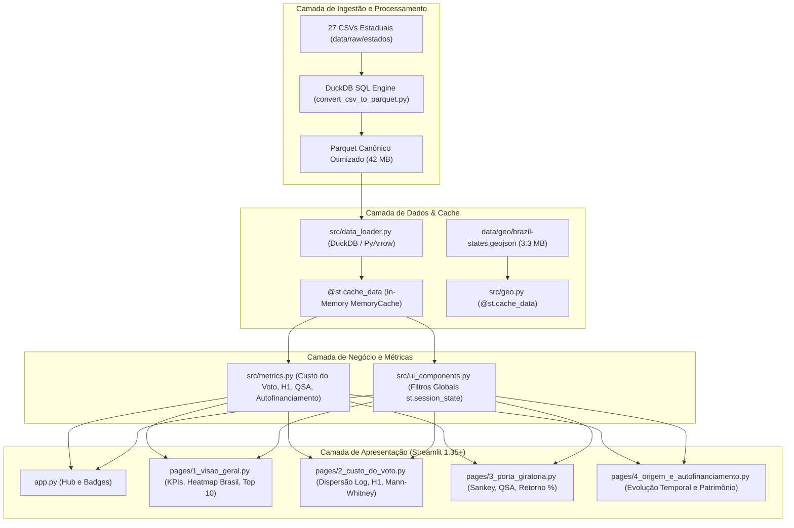

# 🏗️ Arquitetura do Sistema e Engenharia de Dados

Este documento descreve a arquitetura técnica, os padrões de projeto, a estratégia de armazenamento colunar e o ciclo de vida dos dados do **Observatório do Financiamento Eleitoral**.

---

## 🏛️ 1. Visão Geral da Arquitetura

O sistema adota uma arquitetura em camadas otimizada para alto desempenho em exploração analítica local de microdados massivos (~1 milhão de registros), sem a necessidade de um banco de dados relacional tradicional (RDBMS) em servidor remoto.

---

## ⚡ 2. Estratégia de Alto Desempenho (DuckDB + Parquet)

### Por que DuckDB com Apache Parquet?
- **Processamento Vetorial:** O DuckDB executa filtros, agregações e projeções diretamente no grão colunar do arquivo Parquet, lendo apenas as colunas requisitadas sem carregar o arquivo inteiro na memória RAM desnecessariamente.
- **Compressão Snappy:** Redução de ~144 MB de CSVs brutos para **42.13 MB**, acelerando o tempo de I/O em disco.
- **Velocidade de Ingestão:** Conversão e consolidação de 959.770 registros em aproximadamente **2,0 segundos** via DuckDB.

---

## 🧭 3. Navegação Multi-Páginas e Estado Global (`st.session_state`)

A aplicação utiliza o recurso nativo de multi-páginas do Streamlit. Para garantir que os filtros aplicados pelo usuário persistam ao transitar entre as abas:
- **Barra Lateral Centralizada:** A função `renderizar_sidebar()` em `src/ui_components.py` gerencia os seletores de **Ano**, **Cargo**, **Partido** e **Unidade Federativa (UF)**.
- **Sincronização de Estado:** Os valores ativos são armazenados em chaves de sessão (`filtro_ano`, `filtro_cargo`, `filtro_partido`, `filtro_uf`).
- **Visão Nacional Padrão:** Por padrão, o filtro de UF inicializa em `"Todas as UFs (Brasil)"`. Qualquer subpágina acessada reflete imediatamente o escopo geográfico selecionado.

---

## 🗺️ 4. Módulo Geoespacial (`src/geo.py`)

Para fornecer mapas coropléticos interativos de calor (Heatmaps) sem latência de rede e com execução 100% offline:
1. **Malha Cartográfica Local:** O arquivo GeoJSON com a delimitação geográfica das 27 UFs está armazenado em `data/geo/brazil-states.geojson`.
2. **Carregamento Otimizado:** A malha é mantida na memória via `@st.cache_data` (tempo de carregamento < 30ms).
3. **Plotly Choropleth:** Renderização com limites fixos ajustados (`fitbounds='locations'`) e paletas perceptualmente uniformes para evitar viés de saturação.

---

## 🔒 5. Segurança, Privacidade e LGPD

- **Anonimização de Doadores PF:** Função `anonimizar_documento()` mascara os 6 dígitos centrais do CPF (`***.123.456-**`).
- **Auditoria de Fornecedores:** Conexão direta entre CNPJ básico de fornecedores e doadores para investigação de conformidade pública, preservando a transparência ativa preconizada pela LAI (Lei de Acesso à Informação).
