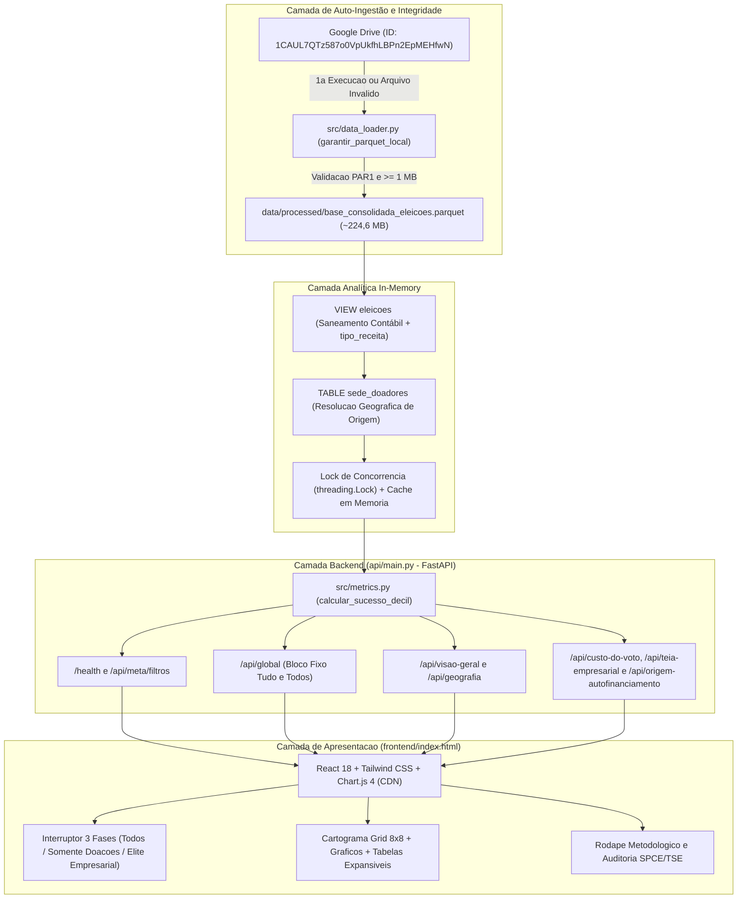

# 🏗️ Arquitetura do Sistema e Engenharia de Dados

Este documento descreve a arquitetura técnica, a estratégia de auto-ingestão da base consolidada e o processamento em memória adotados pelo painel **PACD (Pesquisa Aplicada em Ciência de Dados)**.

---

## 🏛️ 1. Visão Geral da Arquitetura

A plataforma opera inteiramente em arquitetura desacoplada **API Analítica + SPA Standalone**, executando consultas sobre **5.310.738 transações** em milissegundos sem necessidade de servidor de banco de dados externo (RDBMS).

---

## 📦 2. Estratégia de Distribuição Sem Git LFS

Para evitar corrupção de binários e estouro de cota de banda causados por ponteiros de texto do Git LFS (`~130 bytes`), o arquivo `base_consolidada_eleicoes.parquet` **não é versionado no Git** (mantido no `.gitignore`).

No arranque de [api/main.py](../api/main.py) ou ao chamar `carregar_dados()` em [src/data_loader.py](../src/data_loader.py):
1. A função `parquet_integridade_valida()` verifica se o arquivo existe, tem ao menos `1.000.000` de bytes e possui os *magic bytes* binários `b"PAR1"` no início e no fim do arquivo.
2. Caso falhe ou não exista, `garantir_parquet_local()` baixa o arquivo em streaming via `requests.Session` para um arquivo temporário `.parquet.part`, valida os *magic bytes* após o término e substitui o destino de forma atômica.
3. O ID padrão (`1CAUL7QTz587o0VpUkfhLBPn2EpMEHfwN`) pode ser sobrescrito via variável de ambiente `PACD_PARQUET_DRIVE_ID`.

---

## ⚡ 3. Motor DuckDB In-Memory (`api/main.py`)

Ao subir o servidor FastAPI:
- Uma conexão DuckDB em memória (`:memory:`) cria a **`VIEW eleicoes`** sobre o Parquet, aplicando em tempo de leitura:
  - Padronização de `cpf_candidato` com fallback para `sequencial_candidato` quando ausente.
  - **Saneamento cirúrgico de outliers contábeis** autodeclarados no SPCE/TSE (Amazonas 2020 e Salvador/BA 2024).
  - Classificação canônica da coluna derivada **`tipo_receita`** (`Financiamento Privado`, `Repasse entre Aliados`, `Dinheiro Público`).
- Em seguida, é materializada em memória a tabela **`sede_doadores`**, que resolve o estado de origem predominante de cada doador quando `sigla_uf_doador` ou `uf_empresa` estão ausentes.
- Todas as consultas utilizam cursores derivados (`conn.cursor()`) protegidos por `threading.Lock()` e armazenam resultados frequentes em dicionários de cache em memória (`cache_filtros`, `cache_global`, `cache_visao_geral`, `cache_geografia`, `cache_custo_voto`, `cache_teia`, `cache_autofinanciamento`).

---

## 🖥️ 4. Arquitetura Frontend (`frontend/index.html`)

- **Zero Build Step:** React 18, ReactDOM 18, Babel Standalone, Tailwind CSS e Chart.js 4 carregados diretamente via CDN, mantendo a SPA contida em um único arquivo HTML.
- **Estado Reativo Centralizado:**
  - `modoRecurso` (`todos`, `privado`, `elite`) propaga-se tanto para o Bloco Fixo Global quanto para a aba dinâmica ativa.
  - Travas constitucionais entre pleitos gerais (`2018`/`2022`) e municipais (`2020`/`2024`), bloqueio de cargos municipais no `DF` e restauração automática de UF ao alternar cargos.
- **Cartograma Geográfico Nativo:** O Mapa de Calor do Brasil na aba *Análise Geográfica & Fluxo de Recursos* utiliza um **Cartograma Grid 8×8 (`TILE_MAP_GRID`)** implementado nativamente em React/Tailwind sobre as 27 UFs, dispensando malhas GeoJSON externas ou bibliotecas pesadas como Plotly.
