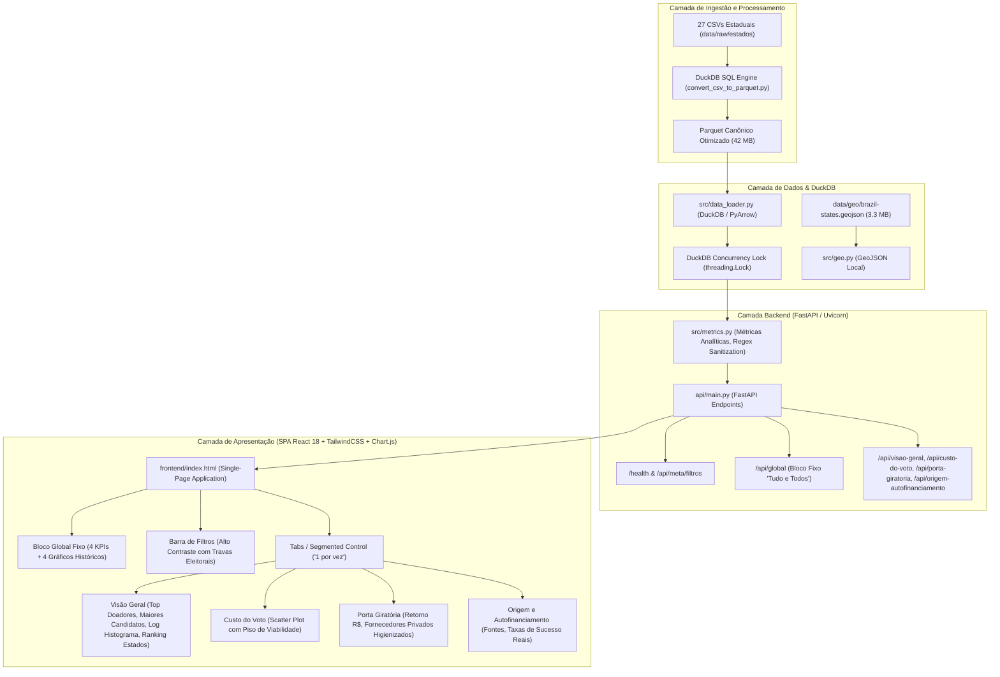

# 🏗️ Arquitetura do Sistema e Engenharia de Dados

Este documento descreve a arquitetura técnica, os padrões de projeto, a estratégia de armazenamento colunar e o ciclo de vida dos dados do **Observatório do Financiamento Eleitoral**.

---

## 🏛️ 1. Visão Geral da Arquitetura

O sistema adota uma arquitetura em camadas otimizada para alto desempenho em exploração analítica local de microdados massivos (~1 milhão de registros), sem a necessidade de um banco de dados relacional tradicional (RDBMS) em servidor remoto.

---

## ⚡ 2. Estratégia de Alto Desempenho (DuckDB + Parquet)

### Por que DuckDB com Apache Parquet?
- **Processamento Vetorial:** O DuckDB executa filtros, agregações e projeções diretamente no grão colunar do arquivo Parquet, lendo apenas as colunas requisitadas sem carregar o arquivo inteiro na memória RAM desnecessariamente.
- **Compressão Snappy:** Redução de ~144 MB de CSVs brutos para **42.13 MB**, acelerando o tempo de I/O em disco.
- **Concorrência Segura (Thread-Safety):** Implementação de cursor dedicado e `threading.Lock()` no backend FastAPI, garantindo execução simultânea sem colisões de conexões assíncronas.
- **Velocidade de Ingestão:** Conversão e consolidação de 959.770 registros em aproximadamente **2,0 segundos** via DuckDB.

---

## 🧭 3. Arquitetura Single-Page Application (SPA) e Diretrizes de UI/UX

A plataforma adota o padrão **Single-Page Application (SPA)** moderna, reativa e sem recarregamento:
- **Zero Textos e Zero Conclusões:** Interface focada puramente na visualização analítica — exclusivamente KPIs, controles de filtro e gráficos com seus títulos objetivos (sem caixas de "insights", textos discursivos ou conclusões).
- **Bloco Global Fixo ("Tudo e Todos"):** Topo da página apresenta métricas e rankings consolidados de toda a base histórica (2018 a 2024), imunes aos filtros.
- **Visualização "1 por vez":** Abaixo do bloco global, o usuário alterna entre as 4 seções analíticas via abas/segmented control, prevenindo sobrecarga visual e scroll excessivo.
- **Barra de Filtros:** Container de alto contraste visual com travas de integridade eleitoral automáticas:
  - Anos Gerais (2018/2022): Restringe aos cargos federais/estaduais/distritais e desativa filtro de município.
  - Anos Municipais (2020/2024): Restringe aos cargos de Prefeito e Vereador.
  - Custo do Voto: Scatter plot unicamente liberado mediante seleção de 1 Ano e 1 Cargo específico.

---

## 🗺️ 4. Módulo Geoespacial (`src/geo.py`)

Para fornecer métricas e rankings geográficos sem latência de rede:
1. **Malha Cartográfica Local:** O arquivo GeoJSON com a delimitação geográfica das 27 UFs está armazenado em `data/geo/brazil-states.geojson`.
2. **Carregamento Otimizado:** Leitura rápida e parsing JSON sem dependências pesadas de frameworks externos.
3. **Ranking Federativo:** Renderização dinâmica das 10 maiores UFs em volume financeiro na SPA via Chart.js.

---

## 🔒 5. Higienização Textual e Segurança

- **Malha Fina Textual (Regex):** Filtragem case-insensitive e insensível a acentuação na detecção de doadores/fornecedores para expurgar entidades institucionais/públicas e repasses de aliados, isolando estritamente relações comerciais privadas na Porta Giratória.
- **Anonimização de Doadores PF:** Função `anonimizar_documento()` mascara os 6 dígitos centrais do CPF (`***.123.456-**`).
- **Auditoria de Fornecedores:** Conexão direta entre CNPJ básico de fornecedores e doadores para investigação de conformidade pública, preservando a transparência ativa preconizada pela LAI (Lei de Acesso à Informação).
